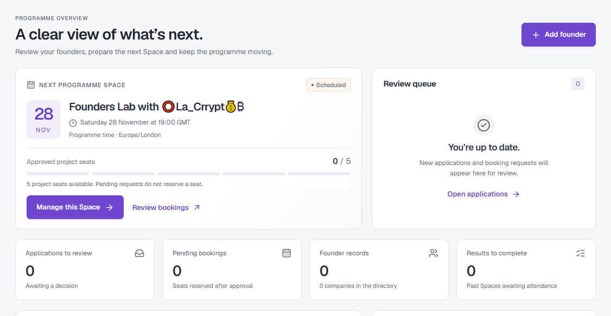
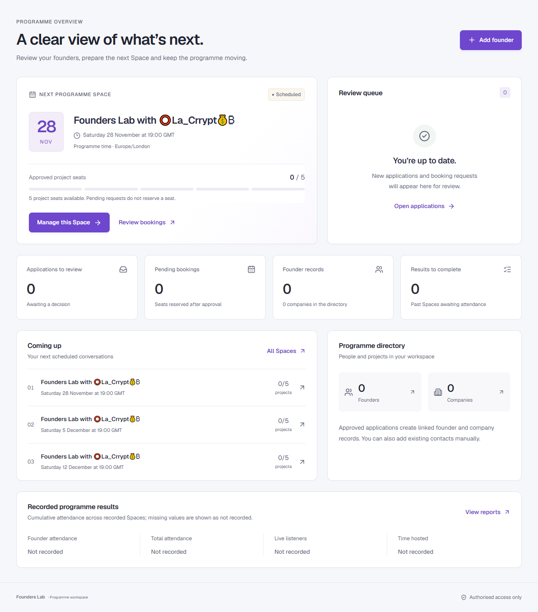
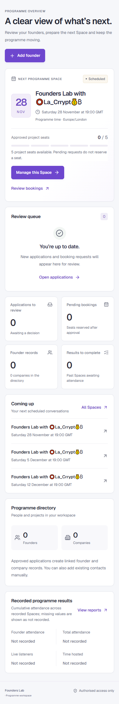

# Admin experience upgrade

The private dashboard put daily work below analytics, used small phone controls and lost unsaved form edits. The upgraded workspace leads with the next programme Space, approved project seats, application/booking review queues and attendance needing completion. It uses the existing licensed Geist font and brand, scoped neutral/violet styles, truthful empty states, searchable founder/company directories and mobile review forms.

The change also fixes UTC clock input shifting to the browser timezone, stale repeated search, incompatible workflow filters, hardcoded account initials and missing mobile sign-out. Failed saves retain field feedback and form input; dirty forms require an explicit discard. Private tables have labelled keyboard scrolling regions, directories paginate consistently, and managers have distinct loading/error/unconfigured-email states with retry. Workspace refresh remains explicit and uses the existing permission-scoped endpoint.

The latest main changes, including public website inputs, host naming and FAQs, are preserved. Server authentication, CSRF, permission checks, capacity locking and Prisma/schema migrations are unchanged. The admin review branch disables automatic Vercel deployment consistently with the earlier review branches.

Validation includes build/TypeScript/lint, source/route checks, authenticated browser regressions and 320–1440px emulated layouts. A separate temporary PostgreSQL database verifies actual winter/summer session create/update/readback, concurrent project-capacity approvals, attendance, manager scope/revocation and deletion/session protections. Email-provider responses in that integration suite are loopback mocks. Physical phones, delivered emails and a deployed admin release require separate verification.

The admin browser suite requires `FOUNDERSLAB_TEST_ADMIN_EMAIL` and `FOUNDERSLAB_TEST_ADMIN_PASSWORD` supplied privately for an isolated local environment. It keeps session cookies in memory, reuses authentication to respect rate limits, and never checks credentials into the repository. Run the existing npm scripts and Playwright suite against the configured local production server. The integration runner creates and drops its own localhost-only test database.

Final local checks: build/TypeScript, 38 source tests, 23 browser tests and 25 route contracts pass. Lint succeeds with two existing warnings in the main-provided icon/share-image generators. The separate PostgreSQL/HTTP runner passes 18 groups, including the latest nullable identity migration and independent Founder/Project X edits. Eight admin routes at seven widths (320/375/393/768/820/1024/1440) produce 56 fitting views, with visible next-session actions and fitting phone forms. Fourteen admin desktop/phone Axe scans plus the server-validation form scan report zero violations. Record dates use UTC consistently to prevent a server/browser hydration mismatch around midnight.

These screenshots show the actual isolated local preview with eight published sessions and zero founder records; they do not represent production counts.

The laptop layout also fits a native1366×768screen at100%zoom (1358×644browser content). The next-session and review panels align, all four work metrics fit above the fold, and account/navigation controls remain visible. Sidebar width and content offset share one responsive value; shorter desktop windows use compact panel spacing. Six laptop/desktop/phone alignment checks have zero Axe violations. The visible preview uses native window dimensions rather than a forced1440×1000test viewport.

## Space Manager passwords

In **Overview → Manage invitations**, use **Set up password** for an existing manager or **Generate password setup link** for a new manager. Share the link privately. Anyone holding it can set the account password before it expires in 15 minutes. Once used, the link cannot be replayed. New managers receive All Spaces access. Existing assignments are preserved.

The manager chooses a password and can sign in again at `/manager/spaces` using the invited email and that password. Sessions expire after eight hours. Generate a **password reset link** if needed. Completing a reset invalidates old sessions and unused links. Revoking access removes the password and invalidates every session and unused invitation.

The release adds two columns through the existing Neon migration pipeline. No email provider or new Vercel settings are required.

## Shared workspace signup

Set a random, unique `WORKSPACE_SIGNUP_KEY` of at least 32 characters as a Sensitive Production variable and redeploy. The signup flow does not use the legacy bootstrap email or password variables. The two members use `/signup#key=YOUR_KEY` privately and register with their own distinct email addresses, in either order. They have the same workspace permissions. An email already attached to an account cannot be reassigned through signup.

After the second workspace account is registered, signup closes automatically and stays closed across deployments. Both members can continue to sign in at `/signin` and save their own login in their password manager. Removing the legacy bootstrap email and password variables retires access for the legacy owner login while preserving its database record.
